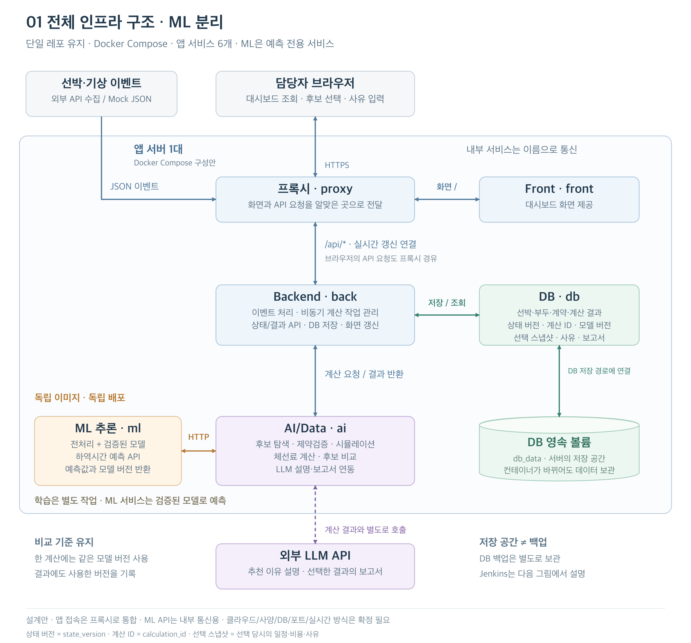
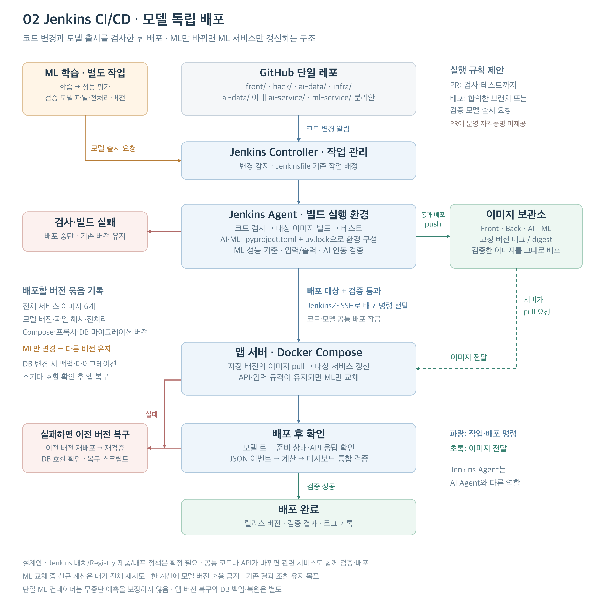

# 전체 서비스·Jenkins CI/CD 구성도

> 단일 레포·Docker Compose·AI/ML 분리 기준 설계다. 실제 서비스 실행·배포 검증 결과가 아니다.

## 전체 서비스 연결

Back이 이벤트·작업·상태와 DB 저장을 관리하고 AI에 계산을 요청한다. AI는 ML에서 하역시간을 예측받고 최적화·계약 규칙 계산을 수행한다. LLM은 근거 설명·선택 결과 보고서에 사용한다. 담당자는 후보를 선택하고 사유를 입력한다.

## Jenkins CI/CD

협업 경로는 feature → dev → main이다. 그림은 검사·빌드·배포의 큰 흐름이며 브랜치 보호의 세부 기준은 [GitHub Rules](github-rules.md)를 따른다. 모델만 갱신할 때에도 AI 호환·모델 버전을 검증한다.

[서비스 구성 SVG](assets/port8282_infra_ml_split_services.svg) · [CI/CD SVG](assets/port8282_infra_ml_split_cicd.svg)

[검토 결과](../architecture-review.md) · [실행 명세](specification.md) · [배포·복구 계획](deployment.md)
